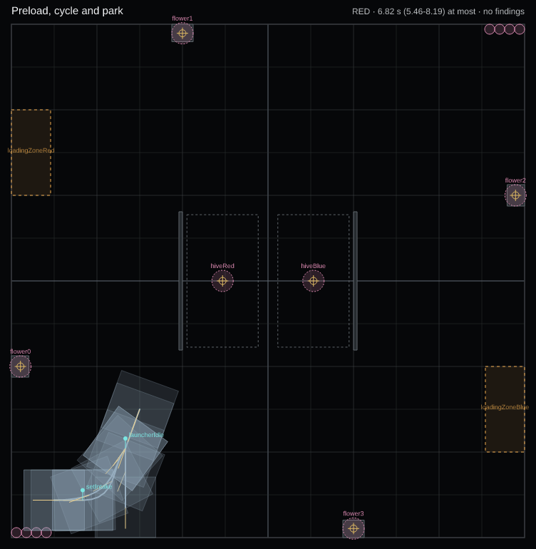

# Horizon Library Examples

This repository holds one example FTC robot that uses [Zenith](https://libraries.horizon36596.org/zenith/)
from start to finish. It is laid out the way a team's own season repository can be: it shows where
the Zenith files live in a robot project, how the robot code registers its commands, and how one auto
file becomes one OpMode on the Driver Station.

The robot is made up. Nothing in it comes from a real robot.



## The example robot

The robot project is called `example-robot`. It is a mecanum robot about 17 by 17 in, with one roller
intake across the front, a hopper that holds 4 pollen, and a fixed launcher at the back with no
turret. It follows paths with Pedro Pathing v3 and runs its commands on SolversLib. Every number in
`autos/robot.json` and `autos/waypoints.json` is a placeholder, marked `PLACEHOLDER` with a short
reason, and so are the constants in the Java. Measure your own robot before you copy any of them.

The one auto, `preload-cycle-park`, starts against the audience wall in RED's half. It launches the
four preloaded pollen, collects four more from the RED garden in one intake pass, launches those, and
parks. Zenith estimates it at 6.8 s of the 30 s autonomous period. When it ends, the Driver Station
selects the **Driver Control** TeleOp, which drives the same subsystems by hand.

## How this repository is laid out

The Android project is the official FtcRobotController v12.0, with the Zenith files beside it at the
root. A season repository can use the same layout. In the table, `TeamCode/...` is
`TeamCode/src/main/java/org/firstinspires/ftc/teamcode`.

| path | what it is |
|---|---|
| `zenith.json` | Where the Zenith files are, where `zenith deploy` copies them, and the command library and robot class the generated Java uses. |
| `autos/` | The robot, the waypoints, the BIOBUZZ field and the auto. Edit these in Zenith. |
| `docs/preload-cycle-park.png` | The auto as `zenith render` draws it. |
| `TeamCode/src/main/assets/autos/` | The copies `zenith deploy` puts in the APK. Do not edit them. |
| `TeamCode/.../zenith/generated/` | The OpMode `zenith deploy` writes for each auto. Do not edit it. |
| `TeamCode/.../zenith/PreloadCycleParkGenerated.java` | The same auto as readable Java, from `zenith codegen`. Do not edit it. |
| `TeamCode/.../zenith/ExampleRobot.java` | The robot as the Zenith runtime sees it. |
| `TeamCode/.../zenith/ExampleCommands.java` | Registers every command and condition name in the table below. |
| `TeamCode/.../subsystems/` | One small SolversLib subsystem each for the drive, intake, launcher and hopper. |
| `TeamCode/.../commands/` | Commands longer than one step, such as `ShootAllCommand`. |
| `TeamCode/.../hardware/` | The device names in the robot configuration, the Pedro Pathing follower setup, and `ExampleSubsystems`, which builds the four subsystems for the autos and the TeleOp alike. |
| `TeamCode/.../teleop/` | The **Driver Control** TeleOp, and `DriverControls`, the one place its buttons are bound. |
| `TeamCode/.../opmodes/` | **Choose alliance**, which sets the alliance the autos run as. |
| `TeamCode/src/test/` | Unit tests, including one that loads the auto through the Zenith runtime and runs it. |
| `TeamCode/src/test/.../sim/` | The Full sim: the robot's fake hardware in SimLoop, and the test that runs an auto against it. |
| `simloop-starter/` | SimLoop's starter folder, copied unchanged. `TeamCode/build.gradle` applies its `simloop.gradle`. |

To build and test the robot code you need Android Studio, or JDK 17 and an Android SDK:

```sh
./gradlew :TeamCode:assembleDebug
./gradlew :TeamCode:testDebugUnitTest
```

`build.dependencies.gradle` adds Zenith v0.1.1, SolversLib 0.3.6 and Pedro Pathing v3 next to the FTC
SDK. `simloop-starter/simloop.gradle` adds SimLoop v0.2.0-alpha.1 for the unit tests only, so none of it
goes into the APK.

## Open it in Zenith

Zenith opens this folder as a robot project, because `zenith.json` is at its root.

- In the desktop app, open this folder.
- In the web app, choose **Open a folder…** in Chrome or Edge, or open this repository from GitHub.
- From a terminal, with Node 22 or newer:

```sh
npx @horizon36596/zenith-cli@0.1.1 validate autos/preload-cycle-park.auto.json
npx @horizon36596/zenith-cli@0.1.1 estimate autos/preload-cycle-park.auto.json
```

After you change a file in `autos/`, run `zenith deploy` and `zenith codegen` again so the copies in
TeamCode match:

```sh
npx @horizon36596/zenith-cli@0.1.1 deploy
npx @horizon36596/zenith-cli@0.1.1 codegen autos/preload-cycle-park.auto.json
```

[Getting started](https://libraries.horizon36596.org/zenith/getting-started/) covers the editor, and
[Robot runtime](https://libraries.horizon36596.org/zenith/robot-runtime/) covers the Java side.

## Run it in the Full sim

Zenith's estimate adds up a time for each step. The Full sim runs the real robot code instead: the
generated OpMode, `ExampleRobot`, the four subsystems, Pedro's follower and the SolversLib scheduler,
on your computer, against fake hardware. [SimLoop](https://libraries.horizon36596.org/simloop/) runs the
OpMode, and `ExampleRobotSim` gives it the fake devices and a mecanum plant to drive. Its physical
numbers are placeholders too, marked `PLACEHOLDER`.

`zenith.json`'s `sim` block tells Zenith how to run it. From a terminal:

```sh
npx @horizon36596/zenith-cli@0.1.1 sim preload-cycle-park
```

This runs `ZenithAutoHeadlessTest` for that one auto, for the 30 s autonomous period plus 2 s. The test
writes `TeamCode/build/sim/preload-cycle-park.trace.json`, and Zenith prints its estimate next to the
time each step took in the sim. The same test also runs in `./gradlew :TeamCode:testDebugUnitTest`,
for every auto, and fails if a step is interrupted or the auto does not finish inside the period.

SimLoop comes from JitPack, so the first build downloads it. To drive your own robot in the Full sim,
start from SimLoop's [starter README](simloop-starter/README.md), then copy `ExampleRobotSim` and
`ZenithAutoHeadlessTest` and give them your robot's devices and measured numbers.

## Commands and conditions

These are the names an auto file may use. `ExampleCommands` registers each one with the Zenith
runtime, and a unit test checks that the Java and `autos/robot.json` list the same names.

| name | arguments | Zenith's time estimate | what it does |
|---|---|---|---|
| `shootAll` | `count`: 1 to 4; `cadence`: `rapid` or `precise` (default `precise`) | `0.35 + count * 0.08` s | Spins the launcher up and launches `count` pollen. `precise` waits for the flywheel between launches. The robot stands still. |
| `setIntake` | `side`: `FRONT`, `BACK` or `BOTH` (default `BOTH`); `state`: `STOP`, `FORWARD` or `REVERSE` (default `STOP`) | 0 s | Sets the intake. The robot has only a front intake, so `FRONT` and `BOTH` run it and `BACK` does nothing. |
| `launcherIdle` | none | 0 s | Drops the launcher to its idle speed. |
| `relocalize` | none | 0 s | Keeps the odometry pose. The robot has no camera to correct it from. |
| `cancelAll` | none | 0 s | Stops the intake, the feeder and the launcher. |
| `hopperFull` | condition | | The hopper holds 4 pollen. |
| `hopperEmpty` | condition | | The hopper holds no pollen. |

## Driving it

Before a match, run **Choose alliance** and press B for RED or X for BLUE. The autos run as that
alliance. **Driver Control** uses gamepad 1, robot-centric:

| control | what it does |
|---|---|
| left stick | Drives forward, back and sideways. |
| right stick, left and right | Turns. |
| right bumper, held | Runs the intake inward. It stops by itself when the hopper is full. |
| left bumper, held | Runs the intake outward, to clear a jam. |
| A | Launches one pollen. |
| Y | Launches all four. |
| B | Drops the launcher to idle and ends a volley. |

To change a control, edit `DriverControls.java`. Its header lists the same controls.

## Licence

Horizon's work in this repository is under the MIT licence, `Copyright (c) 2026 Horizon (FTC 36596)`,
in [LICENSE](LICENSE). FIRST's FtcRobotController project files keep FIRST's own licence, in
[FtcRobotController/LICENSE](FtcRobotController/LICENSE).

Made by Horizon (FTC 36596).
